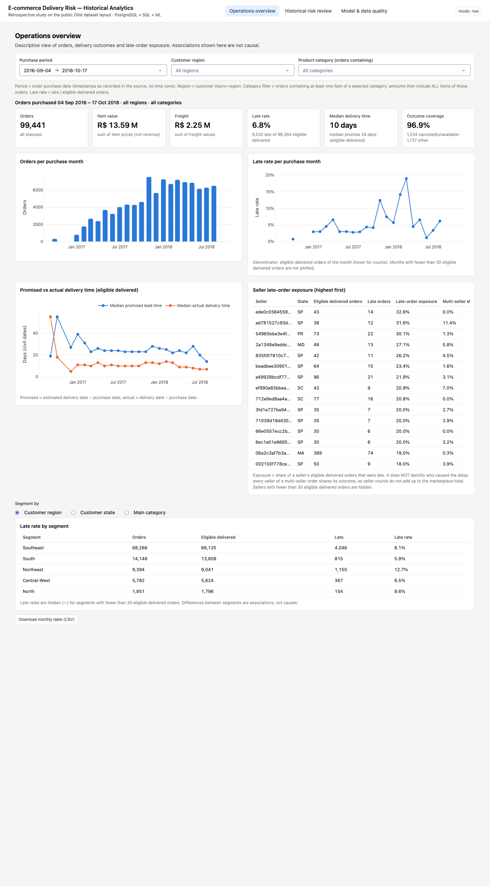

# E-commerce Delivery Risk & Operations Analytics

Retrospective study on the public **Olist** Brazilian e-commerce dataset (99,441 orders, 2016–2018):

> Which orders show a risk of late delivery **at the moment they are approved**, and how should a
> limited operational review capacity be prioritised?

PostgreSQL 17 does the heavy lifting (typed staging with quarantine, verified keys, tested marts,
point-in-time features in SQL); scikit-learn and LightGBM are compared with simple baselines under a
frozen temporal protocol; a three-page Dash application reads the marts with a read-only role.


*Operations overview page on the real data (1440 px).*

## What is in the box

| Area | Highlights | Where |
|---|---|---|
| Ingestion | 9 file contracts, header checks, manifest (size, SHA-256, rows, version, acquisition, load id), idempotent re-imports | `src/delivery_risk/ingestion`, `sql/migrations` |
| Staging / core | strict typing, quarantine with reasons, strict duplicates vs key conflicts, PK/FK after checks, orphan vs cascade | `sql/staging`, `sql/core` |
| Marts | fan-out-safe order summary, order × category, seller late-order exposure, monthly operations (FILTER, LAG, RANK), coverage | `sql/marts` |
| Quality | 44 SQL assertions; critical ones roll back the whole transform | `sql/assertions`, `reports/data_quality/real/` |
| Features | as-of seller history on **delivery** events (strict `< t`), equal weight per distinct seller, allow-list enforced | `sql/features`, `docs/feature_catalog.md` |
| Modelling | constant and seller-history baselines, logistic regression, LightGBM; train → selection → calibration → test with label cut-offs | `src/delivery_risk/modeling` |
| Evaluation | AP, ROC-AUC, Brier, log loss, top-q, paired weekly block bootstrap, daily capacity simulation, ablation | `src/delivery_risk/evaluation`, `reports/evaluation/real/` |
| Application | operations overview, historical risk review (capacity slider, "At approval" vs "Retrospective"), model & data quality | `src/delivery_risk/dashboard` |
| Performance | 3 queries, plans before/after, identical results, index build cost, Dash time measured separately | `reports/sql_performance/real/` |

## Architecture

```text
CSV files ──ingest──▶ raw (text) ──transform: 1 transaction──▶ staging ─▶ core ─▶ marts + labels
                                    (assertions before COMMIT)                       │
                                                         features: 1 transaction ◀───┘
                                                                  │
                     train (never reads test) ─▶ frozen models ─▶ evaluate ─▶ evaluation.* tables
                                                                                  │
                                                       Dash app (read-only role) ◀┘
```

Details: [docs/architecture.md](docs/architecture.md).

## Prerequisites

- [uv](https://docs.astral.sh/uv/) ≥ 0.11 (installs Python 3.12 and the locked dependencies)
- Docker with Compose v2 (PostgreSQL 17.11 container, published on `127.0.0.1:55432` only)
- `make`; optional: Google Chrome/Chromium for `make screenshots`

Tested on macOS 15 (arm64), Docker Desktop 28.4, Python 3.12.13.

## Run it

1. Put the nine Olist CSV files in `data/raw/olist/` ([data/README.md](data/README.md) — browser
   download or Kaggle CLI; the files are never committed).
2. Set up and run the pipeline:
   ```bash
   make setup          # uv sync --frozen + local .env with random passwords (git-ignored)
   make db-up          # PostgreSQL 17 + roles + databases + migrations
   make reproduce      # ingest → transform → quality → features → train → evaluate → report
   make benchmark      # optional: SQL benchmark in an isolated schema
   make dashboard      # http://127.0.0.1:8050
   ```
3. Tests and lint (they use disposable test databases, never the real one):
   ```bash
   make test           # 105 tests: unit, integration, temporal leakage, dashboard
   make lint
   ```

The real splits in `config/splits.yaml` were frozen after the coverage audit
(`reports/data_quality/real/coverage.md`) and before any training; training refuses a block
definition that is not frozen, and evaluation refuses a run whose splits, features or model file
changed since training.

## Commands

| Command | Does |
|---|---|
| `make setup` / `make db-up` / `make db-down` | dependencies + .env / start DB and initialise / stop DB (volume kept) |
| `make ingest transform quality features` | data pipeline steps |
| `make train` / `make evaluate` | temporal protocol / final test (re-runs are logged as verification) |
| `make report` | figures and the detailed evaluation report from saved artifacts |
| `make benchmark` | SQL benchmark in the isolated `bench` schema |
| `make dashboard` / `make dashboard-docker` | Dash app on the host / in Docker (gunicorn, read-only role) |
| `make test` / `make test-fast` / `make lint` | all tests / unit tests only / Ruff lint + format check |
| `make screenshots` | 1440 px and 1024 px captures of the three pages (dashboard running) |
| `make db-reset MODE=real CONFIRM=yes` | **destructive**, explicit: drop and recreate the project schemas of one database |

`uv run delivery-risk --help` lists the underlying CLI.

## Results

Run `20261017T173852Z-64ef33`, evaluated once on the test block
([evaluation report](reports/evaluation/real/evaluation_report.md), [model card](docs/model_card.md)).

**Data.** 99,441 orders (2016-09 to 2018-10); 96,394 delivered with an eligible outcome, **6.8% late**
(civil-date convention). No key conflict or orphan reference; anomalies are counted in the
[quality report](reports/data_quality/real/data_quality_report.md) (775 orders without items,
160 without approval, 610 products without category, …).

**Test block** (approved 2018-05-01 → 2018-08-01): 19,055 delivered eligible orders, 718 late
(prevalence 3.8%). Model chosen on the selection block before test: logistic regression.

| Model | AP [95% weekly-bootstrap CI] | Precision@10% | Lift@10% |
|---|---|---|---|
| Constant (prevalence) | 0.038 [0.021–0.058] | 3.0% | 0.79 |
| Seller-history baseline | 0.043 [0.021–0.066] | 5.1% | 1.36 |
| **Logistic regression (selected)** | **0.075 [0.047–0.115]** | 8.7% | 2.30 |
| LightGBM (not selected) | 0.090 [0.070–0.115] | 10.4% | 2.77 |

- The selected model ranks late orders better than the seller-history rule on AP (paired difference
  +0.032, interval +0.015 to +0.060); the Precision@10% difference is not robust (interval includes 0).
- The level is modest and uneven: most of the gain comes from May 2018; June has a 1.2% late rate.
- A daily review of 10% of approved orders would have targeted orders with an 8.2% late rate (vs 3.8%)
  and covered 22% of known late orders — a retrospective simulation, **not** evidence that reviewing
  them prevents delays.
- Calibrated probabilities over-estimate risk on test (calibration-period late rate 11.1%): use the
  score for ranking and recalibrate on recent deliveries.
- LightGBM did better on test but was not selected; the choice is kept to preserve an independent test.

**SQL performance (real volume,** [benchmark report](reports/sql_performance/real/benchmark.md)**).**
The as-of seller-history query did not finish in 300 s without an index and takes 4.2 s with a
composite index-only scan (11.3 s for a window-function rewrite); the risk-review extraction drops
from 10.5 ms to 0.2 ms with an index; the overview aggregation (18 ms) did not justify one. Results
are identical across variants.

**Tests.** 105 tests (unit, integration against PostgreSQL 17, temporal leakage, dashboard) and Ruff,
run by GitHub Actions against a PostgreSQL 17.11 service container. The SQL seller history was also
checked against an independent Python implementation on all 99,991 real (order, seller) rows.

## Limitations

- Retrospective study on a historical export; no live system; scores are estimated risks.
- The source is a final snapshot: product, price, freight and promise attributes are **assumed**
  known at approval (an ablation without catalog attributes leaves results unchanged).
- Performance is measured on finally delivered orders only; canceled/undelivered orders are scored
  but cannot be evaluated.
- Few test weeks (14) and strong seasonality: intervals are wide and calibration does not transfer
  between periods.
- Label-availability cut-offs leave few late examples for model selection (274 of 1,287 late orders
  of the selection block were delivered before its cut-off).
- Seller histories count delivered orders only; multi-seller outcomes are shared (exposure, not cause).
- Better targeting does not show that reviewing an order prevents a delay; no savings or ROI is
  claimed. Item, freight and payment amounts are not Olist revenue or margin.

## Data attribution

Brazilian E-Commerce Public Dataset by Olist, version 2, available on Kaggle
(<https://www.kaggle.com/datasets/olistbr/brazilian-ecommerce>) under **CC BY-NC-SA 4.0**. Raw data
is not redistributed in this repository.

## Documentation

[Architecture](docs/architecture.md) ·
[SQL walkthrough](docs/sql_walkthrough.md) ·
[Metric definitions](docs/metric_definitions.md) ·
[Feature catalog](docs/feature_catalog.md) ·
[Temporal validation](docs/temporal_validation.md) ·
[Model card](docs/model_card.md) ·
[Data dictionary](docs/data_dictionary.md) ·
[Decision log](docs/decision_log.md)
