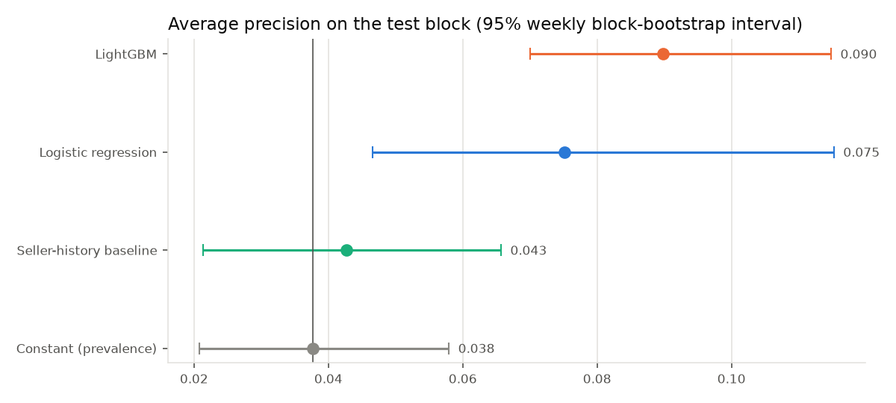
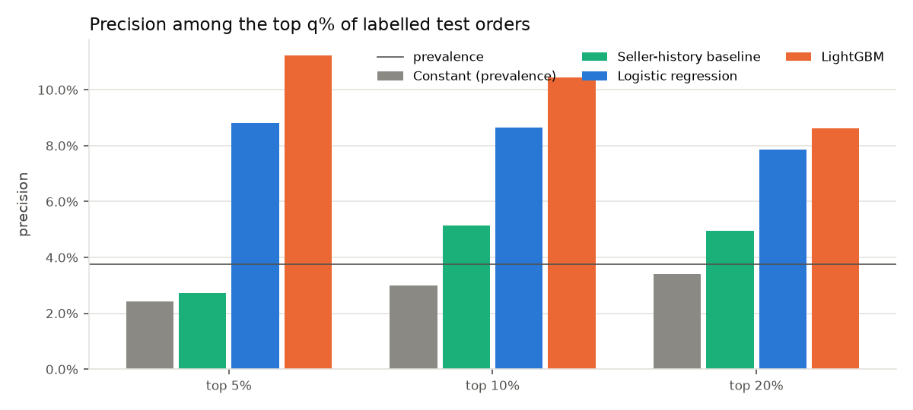
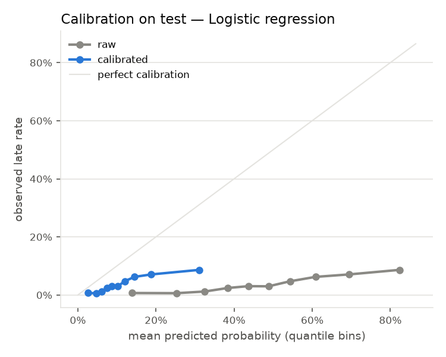

# Evaluation report — real

Source: run `20261017T173852Z-64ef33` (real mode, evaluation kind: final). Generated 2026-10-17. Selected model: **Logistic regression** (highest AP on the selection block).

## Population

Test block (approval date) 2018-05-01 to 2018-08-01 (exclusive): 19,368 scorable orders, of which 19,055 were finally delivered with an eligible outcome (718 late, prevalence 3.8%). Label coverage 98.4%. Performance measured on test orders finally delivered with an eligible outcome; canceled/unavailable/undelivered orders are scored but cannot be evaluated.

## Models vs baselines (test block)

| Model | AP [95% CI] | ROC-AUC | Precision@10% [CI] | Lift@10% | Recall@10% | Brier raw → calibrated |
|---|---|---|---|---|---|---|
| Constant (prevalence) | 0.038 [0.021–0.058] | 0.500 | 3.0% [1.3%–5.0%] | 0.79 | 7.9% | 0.0364 → 0.0364 |
| Seller-history baseline | 0.043 [0.021–0.066] | 0.536 | 5.1% [1.9%–8.8%] | 1.36 | 13.6% | 0.0482 → 0.0417 |
| Logistic regression | 0.075 [0.047–0.115] | 0.708 | 8.7% [5.2%–13.6%] | 2.30 | 23.0% | 0.2520 → 0.0455 |
| LightGBM | 0.090 [0.070–0.115] | 0.700 | 10.4% [7.2%–13.9%] | 2.77 | 27.7% | 0.0361 → 0.0435 |

Intervals: paired bootstrap over ISO weeks, 500 resamples, 0 skipped (undefined metric). With only 14 weeks the intervals are themselves uncertain.

Paired differences against the seller-history baseline:

| comparison | metric | mean diff | 95% interval | share of resamples > 0 |
|---|---|---|---|---|
| Constant (prevalence) | average_precision | -0.0054 | -0.0143 to +0.0010 | 7.2% |
| Constant (prevalence) | precision_at_10 | -0.0217 | -0.0521 to +0.0083 | 9.6% |
| Constant (prevalence) | lift_at_10 | -0.6071 | -1.4261 to +0.2217 | 9.6% |
| Logistic regression | average_precision | +0.0320 | +0.0150 to +0.0601 | 100.0% |
| Logistic regression | precision_at_10 | +0.0340 | -0.0061 to +0.0952 | 93.8% |
| Logistic regression | lift_at_10 | +0.9424 | -0.1624 to +2.2908 | 93.8% |
| LightGBM | average_precision | +0.0486 | +0.0325 to +0.0651 | 100.0% |
| LightGBM | precision_at_10 | +0.0506 | +0.0158 to +0.0938 | 100.0% |
| LightGBM | lift_at_10 | +1.4404 | +0.3794 to +2.6553 | 100.0% |

## Selection block results (used to choose configurations, before test)

| model | config | params | selection AP | selection P@10% |
|---|---|---|---|---|
| Constant (prevalence) | 0 | {} | 0.027 | 3.5% |
| Seller-history baseline | 0 | {} | 0.031 | 3.6% |
| Logistic regression | 0 | {"C": 0.01, "class_weight": null} | 0.063 | 6.6% |
| Logistic regression | 1 | {"C": 0.1, "class_weight": null} | 0.066 | 6.9% |
| Logistic regression | 2 | {"C": 1.0, "class_weight": null} | 0.062 | 6.8% |
| Logistic regression | 3 | {"C": 0.1, "class_weight": "balanced"} | 0.070 | 6.7% |
| LightGBM | 0 | {"num_leaves": 15, "learning_rate": 0.05, "n_estimators": 200, "min_child_samples": 50} | 0.055 | 6.2% |
| LightGBM | 1 | {"num_leaves": 15, "learning_rate": 0.05, "n_estimators": 400, "min_child_samples": 50} | 0.055 | 6.5% |
| LightGBM | 2 | {"num_leaves": 31, "learning_rate": 0.05, "n_estimators": 200, "min_child_samples": 50} | 0.054 | 6.4% |
| LightGBM | 3 | {"num_leaves": 31, "learning_rate": 0.05, "n_estimators": 400, "min_child_samples": 50} | 0.053 | 6.5% |
| LightGBM | 4 | {"num_leaves": 15, "learning_rate": 0.05, "n_estimators": 200, "min_child_samples": 200} | 0.052 | 6.3% |
| LightGBM | 5 | {"num_leaves": 31, "learning_rate": 0.05, "n_estimators": 400, "min_child_samples": 200} | 0.048 | 5.5% |
| LightGBM | 6 | {"num_leaves": 63, "learning_rate": 0.03, "n_estimators": 400, "min_child_samples": 100} | 0.051 | 6.3% |
| LightGBM | 7 | {"num_leaves": 15, "learning_rate": 0.1, "n_estimators": 150, "min_child_samples": 100} | 0.053 | 6.1% |

## Calibration

Sigmoid calibrator fitted on the calibration block (2018-03-01 to 2018-05-01) on labels known before the test start. Brier Logistic regression: raw 0.2520, calibrated 0.0455 — calibration improved the Brier score relative to the raw score, but the calibrated probabilities are still worse than a constant prevalence (Brier 0.0364): the calibrator learned a late rate of 11.1% on the calibration block versus 3.8% on test, so probabilities over-estimate risk on test (rankings are unaffected).

## Daily review-capacity simulation (all scorable test orders)

Each day, the top ceil(q × N_day) orders by frozen score are selected before outcomes are looked at. Precision is computed among selected orders whose outcome is known; ceil() makes the effective share reviewed larger than q on small days.

| Ranking | q | orders selected | effective share reviewed | selected with known outcome | late among selected (known) | late rate, all known | share of known late orders captured |
|---|---|---|---|---|---|---|---|
| Logistic regression | 5% | 1,012 | 5.2% | 97.8% | 8.1% | 3.8% | 11.1% |
| Logistic regression | 10% | 1,976 | 10.2% | 97.8% | 8.2% | 3.8% | 22.0% |
| Logistic regression | 20% | 3,910 | 20.2% | 98.0% | 7.2% | 3.8% | 38.2% |
| Seller-history baseline | 5% | 1,012 | 5.2% | 97.0% | 4.6% | 3.8% | 6.3% |
| Seller-history baseline | 10% | 1,976 | 10.2% | 97.6% | 5.4% | 3.8% | 14.5% |
| Seller-history baseline | 20% | 3,910 | 20.2% | 98.2% | 4.8% | 3.8% | 25.8% |
| Constant (prevalence) | 5% | 1,012 | 5.2% | 98.0% | 2.3% | 3.8% | 3.2% |
| Constant (prevalence) | 10% | 1,976 | 10.2% | 98.3% | 3.1% | 3.8% | 8.5% |
| Constant (prevalence) | 20% | 3,910 | 20.2% | 98.3% | 3.4% | 3.8% | 18.2% |

## Results by group (selected model, test block)

| group type | group | n | late | late rate | AP | P@10% | Lift@10% |
|---|---|---|---|---|---|---|---|
| prediction_month | 2018-05 | 6,940 | 454 | 6.5% | 0.138 | 14.7% | 2.25 |
| prediction_month | 2018-06 | 6,094 | 71 | 1.2% | 0.034 | 4.1% | 3.52 |
| prediction_month | 2018-07 | 6,021 | 193 | 3.2% | 0.048 | 5.1% | 1.60 |
| customer_region | Central-West | 1,119 | 44 | 3.9% | 0.057 | 6.2% | 1.59 |
| customer_region | North | 319 | 14 | 4.4% | 0.103 | 3.1% | 0.71 |
| customer_region | Northeast | 1,771 | 156 | 8.8% | 0.118 | 12.4% | 1.40 |
| customer_region | South | 2,530 | 64 | 2.5% | 0.043 | 5.1% | 2.03 |
| customer_region | Southeast | 13,316 | 440 | 3.3% | 0.067 | 8.3% | 2.50 |
| seller_history_status | all sellers with history | 18,225 | 682 | 3.7% | 0.073 | 8.7% | 2.32 |
| seller_history_status | at least one new seller | 830 | 36 | 4.3% | 0.161 | 8.4% | 1.94 |
| multi_seller | multi-seller | 316 | 1 | 0.3% | — | — | — |
| multi_seller | single seller | 18,739 | 717 | 3.8% | 0.075 | 8.6% | 2.25 |

Model metrics are hidden (—) for groups with fewer than 30 labelled orders or fewer than 10 late orders; raw values remain in `test_metrics_by_group.csv` with their counts.

## Sensitivity: ablation without static catalog attributes (diagnostic only)

| model | features | AP | P@10% | Lift@10% |
|---|---|---|---|---|
| logistic_regression__no_catalog_static | 23 | 0.075 | 8.9% | 2.35 |
| lightgbm__no_catalog_static | 23 | 0.092 | 10.9% | 2.88 |

## Interpretation (associative, calibration block)

Permutation importance of Logistic regression (drop in AP when a feature is shuffled):

| feature | mean AP drop | std |
|---|---|---|
| sh_known_outcomes_90d_min | 0.0561 | 0.0022 |
| customer_state | 0.0545 | 0.0024 |
| sh_known_outcomes_total_min | 0.0480 | 0.0040 |
| promised_lead_days | 0.0465 | 0.0038 |
| any_seller_same_state | 0.0427 | 0.0032 |
| max_seller_distance_km | 0.0420 | 0.0035 |
| sh_approvals_30d_max | 0.0377 | 0.0040 |
| sh_late_rate_90d_mean | 0.0246 | 0.0021 |
| sh_late_rate_90d_max | 0.0205 | 0.0009 |
| primary_seller_state | 0.0062 | 0.0015 |

Largest logistic-regression coefficients (standardised numeric features / one-hot indicators):

| term | coefficient |
|---|---|
| cat__customer_state_AL | 1.277 |
| num__sh_known_outcomes_90d_min | -0.855 |
| cat__customer_state_MG | -0.841 |
| cat__primary_seller_state_PE | -0.781 |
| cat__main_category_market_place | -0.764 |
| cat__main_category_dvds_blu_ray | 0.686 |
| cat__customer_state_PR | -0.672 |
| cat__main_category_art | -0.665 |
| cat__customer_state_MS | -0.663 |
| cat__customer_state_infrequent_sklearn | 0.649 |

These are associations within this dataset, not causes.
